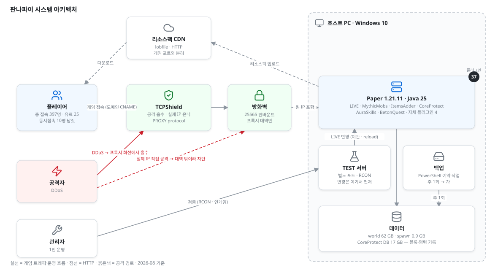
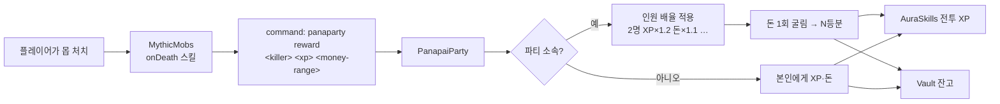

# 판나파이 (Panapai)

> 실사용자가 있는 마인크래프트 경제·RPG 서버. 2024년 8월부터 혼자 24시간 운영하고 있다.

     

<!--
  ★ 수치는 전부 서버 로그·DB·설정에서 실측한 값(2026-08 기준). 문장은 네 말로 다시 써라.
  ★ 접속 도메인·실제 IP·닉네임은 적지 않는다.
  ★ 상세는 Wiki. README 는 소개서.
-->

## 한눈에

| 무엇 | 결과 |
|---|---|
| 밴이 안 통하는 DDoS → 접속 계층을 나눠 프록시 도입 | 하루 재기동 **8회 → 도입 후 26일간 0회** |
| 크래시로 0바이트가 된 스포너 15개, 백업 없이 복원 | 명령 기록 테이블에서 좌표 추출 → **14개 재구성, 12개는 원본 크기와 바이트 단위 일치** |
| 같은 크래시의 리전 파일 손상 범위 특정 | 리전 **9,285개 전수 검사**(자작 스캐너) → 추가 손상 **1청크**로 확정 |
| 2년 24시간 운영 | 총 접속 **397명**(2024-08 ~ 2026-08) · 유료 25명 · 동시접속 10명 · 플러그인 37 · 자체 플러그인 4 |

---

## 1. 소개

바닐라 마인크래프트에 직업·스킬·파티·커스텀 몹·경제를 얹은 RPG 서버다.

친구들끼리 하던 서버에 사람이 늘면서 돈이 돌고, 레벨이 오르고, 보스가 있는 구조가 필요해졌다. 기성 RPG 플러그인을 사는 대신 무료 플러그인을 조합했고, 조합으로 안 되는 부분은 플러그인을 직접 만들어 채웠다. <!-- 네 말로 -->

2년 동안 397명이 접속했고, 그중 134명은 2026년에도 들어온다. 유료 사용자는 약 25명, 동시접속은 10명 남짓이다. 작은 서버지만 실제로 결제가 일어나고, 실제로 공격을 받았고, 유저가 실제로 떠나기도 한다.

개인 PC에서 프록시 뒤에 두고 운영한다. 설정을 바꿀 때는 같은 PC의 테스트 서버에서 먼저 돌려 본 뒤 라이브에 옮긴다.

---

## 2. 운영 인프라

모든 선택의 기준은 **"비용 0에 가깝게, 대신 내가 감당할 수 있는 리스크만"** 이었다.

| 영역 | 선택 | 왜 |
|---|---|---|
| 호스트 | 개인 PC (Ryzen 5 3600 · 32 GB · Windows 10) | 유료 호스팅은 규모 대비 고정비가 크고, 무료 클라우드(OCI ARM 2코어)는 메인 스레드 성능이 부족 |
| 서버 코어 | Paper 1.21.11 · Java 25 | 성능 패치 + PROXY protocol 내장 + 플러그인 생태계 |
| DDoS 방어 | TCPShield 무료 + 방화벽 대역 제한 + A레코드 삭제 | 비용 0, 당일 적용, 서버 무변경. 단일 실패점은 알고 감수 |
| 콘텐츠 | MythicMobs · ItemsAdder · FreeMinecraftModels | 유료 ModelEngine 대신 무료 FMM — 히트박스 제약은 베이스 엔티티 교체로 우회 |
| 기록·복구 | CoreProtect | 블록·**명령** 로깅. 백업이 죽었을 때 복원의 마지막 수단이 됐다 |
| 검증 | 같은 PC의 TEST 서버, RCON은 TEST만 | LIVE 공격면 축소. 명령은 수동 |
| 백업 | PowerShell → 7z, 주 1회 | 47일간 조용히 실패한 적이 있다 |

각 선택의 대안과 감수한 것 → [Wiki 01. 인프라와 배포](https://github.com/sarapoba/minecraft-server/wiki/01.-인프라와-배포)

---

## 3. 시스템 아키텍처

<!-- 수정은 docs/architecture.drawio 를 draw.io 에서 열어서 -->

플레이어는 도메인(CNAME)으로 TCPShield에 붙고, 서버 포트는 TCPShield 대역만 열려 있다. 서버는 PROXY protocol로 원 IP를 받아 밴·로그가 정상 동작한다. 리소스팩은 게임 포트가 아니라 외부 CDN으로 나간다. 변경은 같은 호스트의 TEST 서버에서 먼저 돌린다.

---

## 4. 트러블슈팅

### ① 밴이 안 통하는 DDoS — 접속 계층을 나누고 프록시를 앞에 세웠다
2025-02-28, 밴 3건을 눌렀지만 37초 뒤 서버를 내렸고 3시간 동안 재기동 8회, 마지막엔 포트 바인딩 실패. 가진 방어 수단(밴·화이트리스트·IP 밴·패킷 제한)이 전부 로그인 이후 계층에 있었고, 문제는 TCP 수락 이전에서 나고 있었다. 대안 4개를 비교해 TCPShield 무료 플랜을 골랐고, A레코드 삭제·방화벽 대역 제한·PROXY protocol을 한 세트로 적용했다. 전환 중 리소스팩 HTTP 단절과 PROXY protocol 불일치로 두 번 전원 접속 불가를 겪었다.

**결과** — 하루 재기동 8회 → 도입 후 26일간 0회. 도메인 조회 `online: true` / 실제 IP 직접 조회 `online: false` 동시 확인.
→ [Wiki 02. 네트워크와 보안](https://github.com/sarapoba/minecraft-server/wiki/02.-네트워크와-보안) · [블로그](https://sarapoba.tistory.com) <!-- 발행 후 URL 교체 -->

### ② 크래시로 0바이트가 된 스포너 15개 — 명령 기록 테이블에서 좌표를 되찾았다
2026-08-26 호스트 PC가 죽으면서 스포너 설정 15개가 NUL로 덮였다. 백업은 47일째 조용히 실패 중, TEST 서버엔 2개뿐. 스포너는 `/mm s create`를 플레이어 위치에서 쳐서 만든다는 점에서, 블록 로깅용 CoreProtect의 `co_command` 테이블(명령 + 실행 좌표)을 뒤져 create 15건과 set 파라미터를 시간순으로 재생했다.

**결과** — 14개 재구성, NUL 파일에 남은 원본 크기와 **12개가 바이트 단위로 일치**. 같은 DB로 유실 청크 54개의 건축 기록 78,116건 확인. 추가 손상을 찾으려 리전 9,285개를 전수 검사해 1청크로 특정.
→ [Wiki 05. 데이터와 복구](https://github.com/sarapoba/minecraft-server/wiki/05.-데이터와-복구) · [블로그](https://sarapoba.tistory.com) <!-- 발행 후 URL 교체 -->

### 그 밖의 이슈 12건
리소스팩 캐시 고착 · 3D 모델 히트박스 0.60→1.95 · `allow-flight` 오탐 7명 · 파티 캐시 두 겹 · 호스트 BSOD → 랜 드라이버 · 네트워크 스택 정지 · 상점 표지판 OP 테스트 함정 · … → [Wiki 06. 운영 이슈와 트러블슈팅](https://github.com/sarapoba/minecraft-server/wiki/06.-운영-이슈와-트러블슈팅)

---

## 5. 주요 기능

| 영역 | 내용 | 규모 |
|---|---|---:|
| 🗡️ 직업 스킬 | 검사·암살자·아케이드·불사조·궁수·아케이니스트. 클릭·웅크리기·F·Q 조합 입력 | 6직업 |
| 👥 파티 사냥 | 인원별 XP·돈 배율(2명 ×1.2 … 4명 ×1.4), 한 마리당 보상 1회 굴림 후 분배 | 최대 4명 |
| 👾 커스텀 몹 | 레벨 공식(HP = 8+Lv×2 · 공격 = Lv×0.5 · 돈 = Lv×2~3)으로 사다리 구성 | 몹 60 · 3D 모델 7 · 스포너 14 |
| 👑 필드 보스 | 우두머리 돼지(Lv.12) · 워시룸(Lv.20). 처치 시 스포너 쿨다운 리셋 | 2 |
| 🎒 커스텀 아이템 | 무기·장비·가구·모자·이펙트. 리소스팩 자동 생성 | 아이템 542 · 카테고리 37 |
| 💰 경제 | 표지판 상점 · 주민 상점 · 플레이어 마켓. 몹 처치 보상이 화폐 발행원 | 표지판 63 · 주민 16 |
| 🎩 코스메틱 | 모자·날개·꼬리 등 유료 판매 | 43 |
| 📜 퀘스트 | NPC 대화·저널 | 패키지 7 · NPC 6 |
| 🛡️ 아이템 보호 | 커스텀 아이템이 주민 거래·모루·제작대에서 바닐라 재료로 오인식되는 것 차단 (자체 플러그인) | — |

설계 근거(레벨 공식·파티 배율·보스 양식·경제 진단) → [Wiki 04. 경제와 보상 설계](https://github.com/sarapoba/minecraft-server/wiki/04.-경제와-보상-설계)

---

## 6. 워크플로 — 몹 처치 보상이 파티에 분배되기까지

몹 정의(MythicMobs YAML)에서 자체 플러그인(분배 규칙)을 거쳐 레벨·경제 플러그인(AuraSkills·Vault)으로 흐른다. 보상 규칙을 한 곳에 모아 두어 몹 60종이 같은 공식을 쓴다.

---

## 7. TEST → LIVE 반영

CI/CD는 없지만 절차는 있다. TEST에 먼저 적용해 기동 로그와 인게임(RCON·NBT 조회)으로 검증하고, 환경 파일을 제외한 변경분만 LIVE로 옮긴 뒤 `/mm reload`·`/iazip`·재시작 중 해당하는 것을 실행하고 기동 로그 수치가 TEST와 같은지 확인한다.
→ [Wiki 01. 인프라와 배포 §4](https://github.com/sarapoba/minecraft-server/wiki/01.-인프라와-배포)

---

## 8. 기술 문서 (Wiki)

| 페이지 | 내용 |
|---|---|
| [01. 인프라와 배포](https://github.com/sarapoba/minecraft-server/wiki/01.-인프라와-배포) | 호스트·코어 선택과 트레이드오프, 기동 설정, 반영 절차, 백업 실패 진단 |
| [02. 네트워크와 보안](https://github.com/sarapoba/minecraft-server/wiki/02.-네트워크와-보안) | DDoS 대응 전 과정, 깨진 것 둘, allow-flight·안티치트 트레이드오프 |
| [03. 콘텐츠 엔진](https://github.com/sarapoba/minecraft-server/wiki/03.-콘텐츠-엔진) | MythicMobs·ItemsAdder·FMM 선택 이유, 히트박스 실측, 두 엔진의 함정 |
| [04. 경제와 보상 설계](https://github.com/sarapoba/minecraft-server/wiki/04.-경제와-보상-설계) | 레벨 공식·사다리, 파티 배율, 보스 양식, 재질 충돌과 경제 누수 |
| [05. 데이터와 복구](https://github.com/sarapoba/minecraft-server/wiki/05.-데이터와-복구) | CoreProtect 구조, 스포너 복원, 청크 복구 경로, 리전 전수 검사 |
| [06. 운영 이슈와 트러블슈팅](https://github.com/sarapoba/minecraft-server/wiki/06.-운영-이슈와-트러블슈팅) | 문제 12건 — 문제 → 원인 → 해결 → 결과 |
